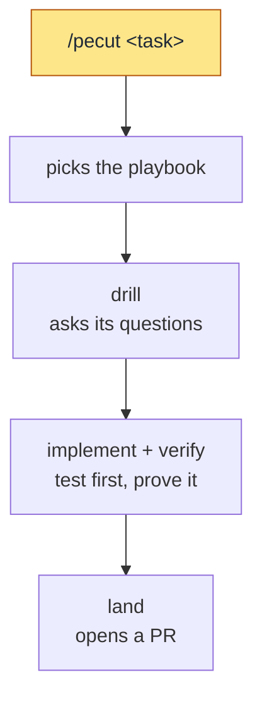

# skills

[](https://skills.sh/pwguler/skills)

Built against the Triple Debt Model (Storey, [arXiv:2603.22106](https://arxiv.org/abs/2603.22106))

## Versions

- **v2** (`main`, v2.0.0): `/pecut` routes each task to a playbook, and the playbook runs the skills in order. v2 is highly inspired by [pstack](https://github.com/cursor/plugins/tree/main/pstack), by Lauren Tan ([poteto](https://x.com/poteto)): pecut is modeled on its poteto-mode, and the playbooks and the 24 `principle-*` skills on its playbooks and principles. Where pstack lives in Cursor and by default hands code work to Grok, v2 runs in every harness that loads skills, on whatever model the session runs.
- **v1** (the `v1` branch, v1.29.2): you run each skill yourself, or a skill starts when its description matches the request. Install shows how to pin it.

## Install

Two paths, both for Claude Code. Pick one: installing both loads every skill twice.

**`npx skills`**:

```bash
npx skills add pwguler/skills
```

**Plugin** (updates via version):

```bash
claude plugin marketplace add pwguler/skills
claude plugin install pwguler-skills
```

Or in a Claude Code session:

```bash
/plugin marketplace add pwguler/skills
/plugin install pwguler-skills
```

Version 1 stays on the `v1` branch: append `#v1` to the source, as in `npx skills add pwguler/skills#v1` or `claude plugin marketplace add pwguler/skills#v1`.

## Update

**`npx skills`**:

```bash
npx skills update
```

**Plugin**:

```bash
claude plugin update pwguler-skills
```

Restart Claude Code after updating.

## The loop

Start a session with `/pecut` (`/skill:pecut` in pi), with a task or without one. From then on every task goes through pecut: it routes the task to the playbook for its type, and the playbook runs the skills in order. Each skill checks its own work and stops, and the playbook starts the next one. You still answer drill's questions and every decision only you can make. `land` opens a pull request; it merges locally into the base branch only when you ask.

The base suite (drill → implement → verify → land) implements the run-until-done loop: a bounded goal, a maker/checker cycle, an exit only on proven criteria. A quality claim no command can settle exits through `rubric`, judged by someone who did not make the work. Fast path: an obvious task skips the interview; one sentence is the plan, once it passes the fork test. If `verify` fails twice on a fast-path task, the task was not obvious: `verify` stops, and pecut sends the task back through drill's interview.

A feature through pecut. The yellow step is the command you type.



The documents the suite maintains, all created lazily with no setup step: `CONTEXT.md` (domain glossary, born from the first resolved term), `ARCHITECTURE.md` (the system as it is), `DESIGN.md` (the look: tokens, type, color, spacing; `prototype` grounds in it), `docs/adr/` (hard-to-reverse decisions), `docs/specs/<slug>.md` (the loop's steering artifact; a spec kept after its branch is a record of why the code looks the way it does). These are shared project artifacts: committed, human-readable, reviewed in PRs. Claude's auto-memory is per-user preference and never replaces them; neither writes to the other.

## What pecut runs

| Part | What it is |
|---|---|
| `/pecut` | The way in: it routes each task to the playbook for its type. |
| Playbooks | The order of the work for one type of task, in `skills/pecut/references/`: bug fix, feature, refactoring, investigation, shipping, and the rest. |
| Skills | One job each, from `drill` to `land`: each checks its own work and stops. |
| Principles | The `principle-*` skills: one rule each, applied by a skill or a playbook at a named moment. |
| `/recall` | Yours to run when pecut offers it, after a playbook that wrote code: it tests your understanding of that code. |
