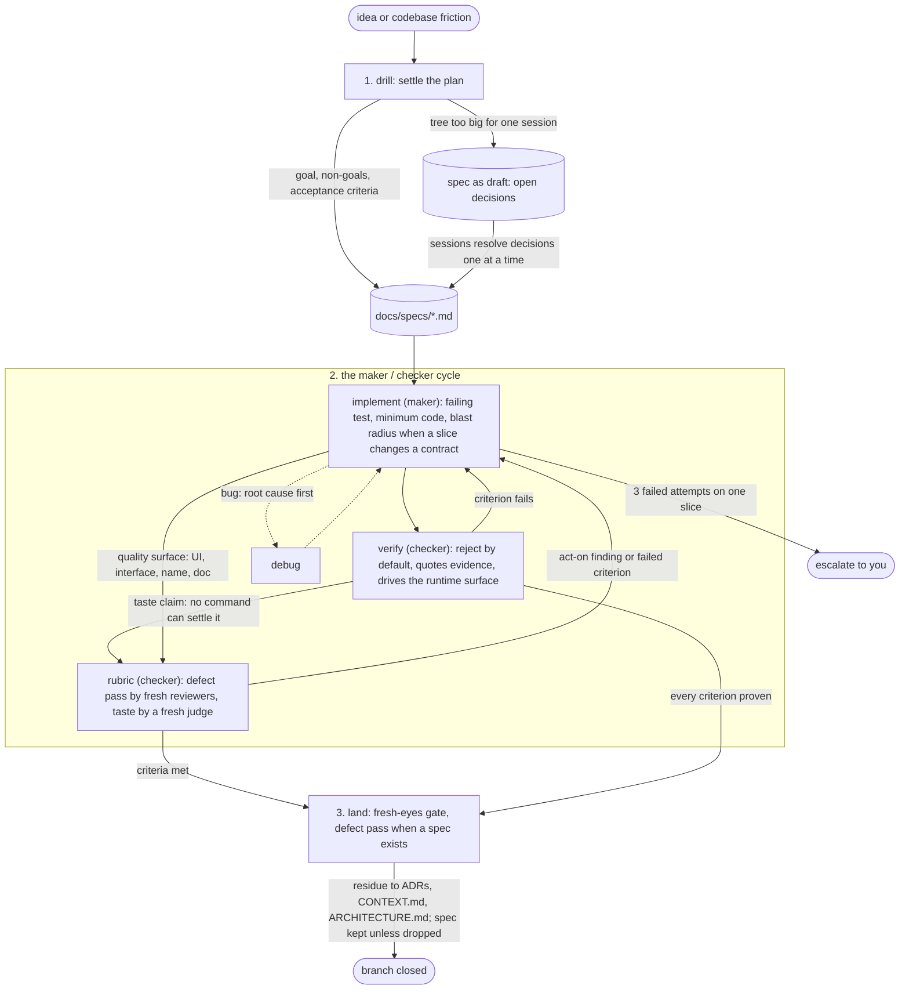

# skills

Built against the Triple Debt Model (Storey, [arXiv:2603.22106](https://arxiv.org/abs/2603.22106))

## Install

The suite runs in [pi](https://pi.dev). Two ways in; pick one, since with both every skill loads twice and pi keeps the first copy it finds.

**pi package**:

```bash
pi install git:github.com/pwguler/skills
```

**`npx skills`**:

```bash
npx skills add pwguler/skills
```

For the same reason, a pi package install needs any older copy of these skills gone from `~/.agents/skills/` and `~/.pi/agent/skills/`.

## Update

**pi package**:

```bash
pi update git:github.com/pwguler/skills
```

**`npx skills`**:

```bash
npx skills update
```

You may need to reinstall to get all skills.

Run `/reload` in an open session to load the new version.

## The loop

The base suite (drill → implement → verify → land) implements the run-until-done loop: a bounded goal, a maker/checker cycle, an exit only on proven criteria. A quality claim no command can settle exits through `rubric`, judged by someone who did not make the work. Before work with a spec lands, `rubric`'s defect pass sends the diff to fresh reviewers. Fast path: an obvious task skips the interview; one sentence is the plan, once it passes the fork test. If `verify` fails twice on a fast-path task, the task was lying: route back through drill. `/skill:deep` is user-only and turns every fast path off for the session.

The 24 engineering principles the work rests on (fix root causes, test behavior not implementation, make operations idempotent, explain the number, and the rest) live in the skill whose step or rule they deepen, and open at that step, so a session pays for one only when it reaches it.



The documents the suite maintains, all created lazily with no setup step: `CONTEXT.md` (domain glossary, born from the first resolved term), `ARCHITECTURE.md` (the system as it is), `DESIGN.md` (the look: tokens, type, color, spacing; `prototype` grounds in it), `docs/adr/` (hard-to-reverse decisions), `docs/specs/<slug>.md` (the loop's steering artifact; a spec kept after its branch is a record of why the code looks the way it does), `.pi/skills/verify-<app>/` (the recipe `verify` drives the app with, written and updated only when you ask). These are shared project artifacts: committed, human-readable, reviewed in PRs.

## When to use what

| Moment | Skill |
|---|---|
| New plan, feature, or design, including the structure of a new codebase or area | `drill` |
| Any topic you want settled by being questioned one fork at a time (`drill` runs it for plans) | `core-interview` |
| A design fork needs a throwaway to react to | `prototype` |
| Implementing a settled plan | `implement` |
| Bug or unexpected behavior | `debug` |
| About to claim done, fixed, or passing; write or update the app's verification recipe | `verify` |
| A defect review of a change, or quality no command can settle | `rubric` |
| Reading legwork, or why code is shaped the way it is | `research` |
| Branch done, needs merging or a PR | `land` |
| Parallel work you ask for: independent tasks, a race between attempts, or coverage across slices | `parallel` |
| Authoring or editing anything an agent reads | `write-skill` |
| A slice the agent wrote landed, test your understanding of it | `recall` |
| A task finished, or you want to catch up since your last message | `tldr` |
| Risky or ambiguous work, full rigor wanted | `deep` |
