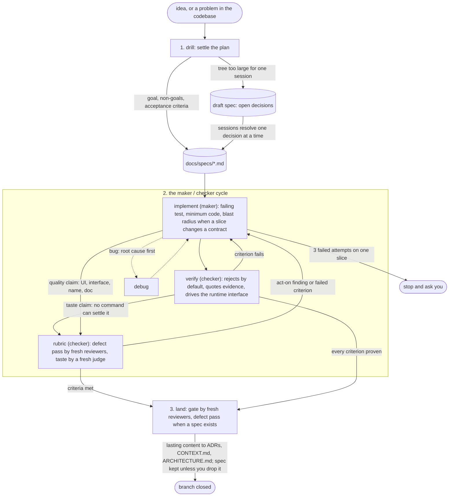

# skills

[](https://skills.sh/pwguler/skills)

This suite works against the three debts of the Triple Debt Model (Storey, [arXiv:2603.22106](https://arxiv.org/abs/2603.22106)). These debts grow when code arrives faster than people can follow it:

- **Technical debt** is in the code. `implement` builds test-first in thin slices, and `debug` fixes the root cause. `perf` measures before it changes code for speed. `verify` checks the result against evidence, and `rubric` sends it to fresh reviewers.
- **Cognitive debt** is in the people, when their shared understanding of the system fades. `tldr` reports results, not transcripts. `recall` rebuilds where work stands from past sessions. `research` finds out why code has its shape. `CONTEXT.md` and `ARCHITECTURE.md` keep the shared knowledge of the system current.
- **Intent debt** is in what nobody wrote down: reasons, goals, and constraints. `drill` writes the goal and the constraints into a spec, and decisions that are hard to undo into ADRs. `land` keeps the spec as the record of why.

## Install

The suite runs in any coding agent that reads [Agent Skills](https://agentskills.io). Install it with `npx skills`. It asks which agents get the suite:

```bash
npx skills add pwguler/skills
```

## Update

```bash
npx skills update
```

If a skill is missing after the update, install the suite again.

Start a new session to load the new version.

## The loop

The base suite (drill → implement → verify → land) is a loop that runs until the work is done. It has a bounded goal and a maker/checker cycle, and it exits only when every criterion is proven. A quality claim that no command can settle goes to `rubric`. A judge who did not make the work decides it. Before work with a spec lands, the `rubric` defect pass sends the diff to two fresh reviewers. One of them runs on another model family.

Fast path: an obvious task skips the interview. One sentence is the plan, when that sentence shows no decision to make. If `verify` fails twice on a fast-path task, the task was not obvious. Then the task goes back through `drill`.

Subtraction comes first. In each file that a slice or a fix changes, the dead code goes before anything new comes in. So does each comment that repeats the code or excuses a workaround.

The work rests on 24 engineering principles. Examples are "fix root causes", "make operations idempotent", and "explain the number". Each principle is in the skill whose step or rule it adds detail to. It opens at that step, so a session reads a principle only when it reaches that step.



The suite keeps these documents. Each one appears when the work first needs it, with no setup step:

- `CONTEXT.md`: the domain glossary. It starts with the first settled term. A repo with several contexts has one for each context, and lists them in `CONTEXT-MAP.md`.
- `ARCHITECTURE.md`: the system as it is now.
- `DESIGN.md`: the look, as tokens for typography, color, and spacing. `prototype` builds on it, and `implement` builds UI from it.
- `docs/adr/`: decisions that are hard to undo.
- `docs/specs/<slug>.md`: the spec that guides the loop. A spec kept after its branch records why the code looks the way it does.
- `docs/research/`: the findings that resolve the AFK decisions of a draft spec.
- `verify-<app>`: a project skill, the recipe that `verify` uses to drive the app. `verify` offers to write one when the app has none. It writes or updates the recipe only when you ask.

These files are part of the project. They live in the repository, people can read them, and PRs review them like code.

## When to use what

You can also start any skill yourself, with the skill command of your agent.

| Moment | Skill |
|---|---|
| A new plan, feature, or design, or the structure of a new codebase or area | `drill` |
| A topic that you want settled through questions, one decision at a time (`drill` runs it for plans) | `core-interview` |
| A design decision that needs a throwaway to react to | `prototype` |
| A settled plan to implement | `implement` |
| A bug or unexpected behavior | `debug` |
| Slow code, high latency or memory use, a hang, or a profile or trace file to read | `perf` |
| Before you say done, fixed, or passing, or to write or update the verification recipe of the app | `verify` |
| A defect review of a change, or a quality that no command can settle | `rubric` |
| A fact from the owner of a library, service, or standard, why code has its shape, or reading to give to a subagent | `research` |
| A finished branch that needs a merge or a PR | `land` |
| Parallel work that you ask for: independent tasks, a race between attempts, or coverage of many parts of one job | `parallel` |
| A document that an agent reads, to write or edit, or the same agent mistake corrected a second time | `write-skill` |
| The start or continuation of work: where it stands, from past sessions. Start it yourself | `recall` |
| The end of a session with corrections, errors, or surprises: each lesson goes to a check, a skill, or a project file. Start it yourself | `reflect` |
| A finished task, or a catch-up on this session since your last message | `tldr` |
