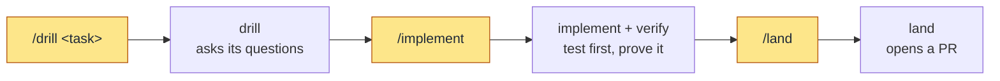
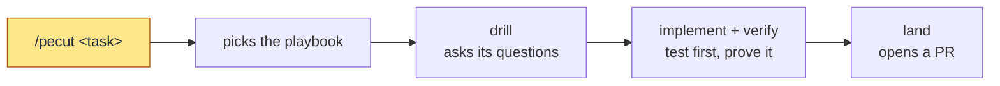

# skills

[](https://skills.sh/pwguler/skills)

Built against the Triple Debt Model (Storey, [arXiv:2603.22106](https://arxiv.org/abs/2603.22106))

## Install

Two paths, both for Claude Code. Pick one: installing both loads every skill twice.

**`npx skills`**:

```bash
npx skills add pwguler/skills
```

**Plugin** (updates via version):

```bash
claude plugin marketplace add pwguler/skills
claude plugin install pwguler-skills
```

Or in a Claude Code session:

```bash
/plugin marketplace add pwguler/skills
/plugin install pwguler-skills
```

Restart Claude Code after installing.

## Update

**`npx skills`**:

```bash
npx skills update
```

**Plugin**:

```bash
claude plugin update pwguler-skills
```

Restart Claude Code after updating.

## The loop

The base suite (drill → implement → verify → land) implements the run-until-done loop: a bounded goal, a maker/checker cycle, an exit only on proven criteria. A quality claim no command can settle exits through `rubric`, judged by someone who did not make the work. Fast path: an obvious task skips the interview; one sentence is the plan, once it passes the fork test. If `verify` fails twice on a fast-path task, the task was not obvious: `verify` stops, and under `/pecut` the task goes back through drill's interview. `/pecut` is the other door, and it is user-only: it routes a task to the playbook for its type, and the playbook starts each skill in turn, since no skill starts another.

A feature, both ways. The yellow steps are the commands you type.

**Manual**: you start each skill.



**Pecut**: `/pecut` starts each skill in the playbook's order; you still answer drill's questions.



Either way, `land` opens a pull request; it merges locally into the base branch only when you ask.

The documents the suite maintains, all created lazily with no setup step: `CONTEXT.md` (domain glossary, born from the first resolved term), `ARCHITECTURE.md` (the system as it is), `DESIGN.md` (the look: tokens, type, color, spacing; `prototype` grounds in it), `docs/adr/` (hard-to-reverse decisions), `docs/specs/<slug>.md` (the loop's steering artifact; a spec kept after its branch is a record of why the code looks the way it does). These are shared project artifacts: committed, human-readable, reviewed in PRs. Claude's auto-memory is per-user preference and never replaces them; neither writes to the other.

## When to use what

| Moment | Skill |
|---|---|
| New plan, feature, or design, including the structure of a new codebase or area | `drill` |
| The interview loop `drill` runs, not run on its own | `core-interview` |
| A design fork needs a throwaway to react to | `prototype` |
| Implementing a settled plan | `implement` |
| Bug or unexpected behavior | `debug` |
| About to claim done, fixed, or passing | `verify` |
| Quality no command can settle: a design, a UI, prose | `rubric` |
| Reading legwork | `research` |
| Branch done: open a PR, or merge locally when you ask | `land` |
| Independent failures or tasks, two or more | `parallel` |
| Authoring or editing anything an agent reads | `write-skill` |
| A slice the agent wrote landed, test your understanding of it | `recall` |
| A task finished, you want the short version | `tldr` |
| Any task, run through the playbook for its type | `pecut` |
