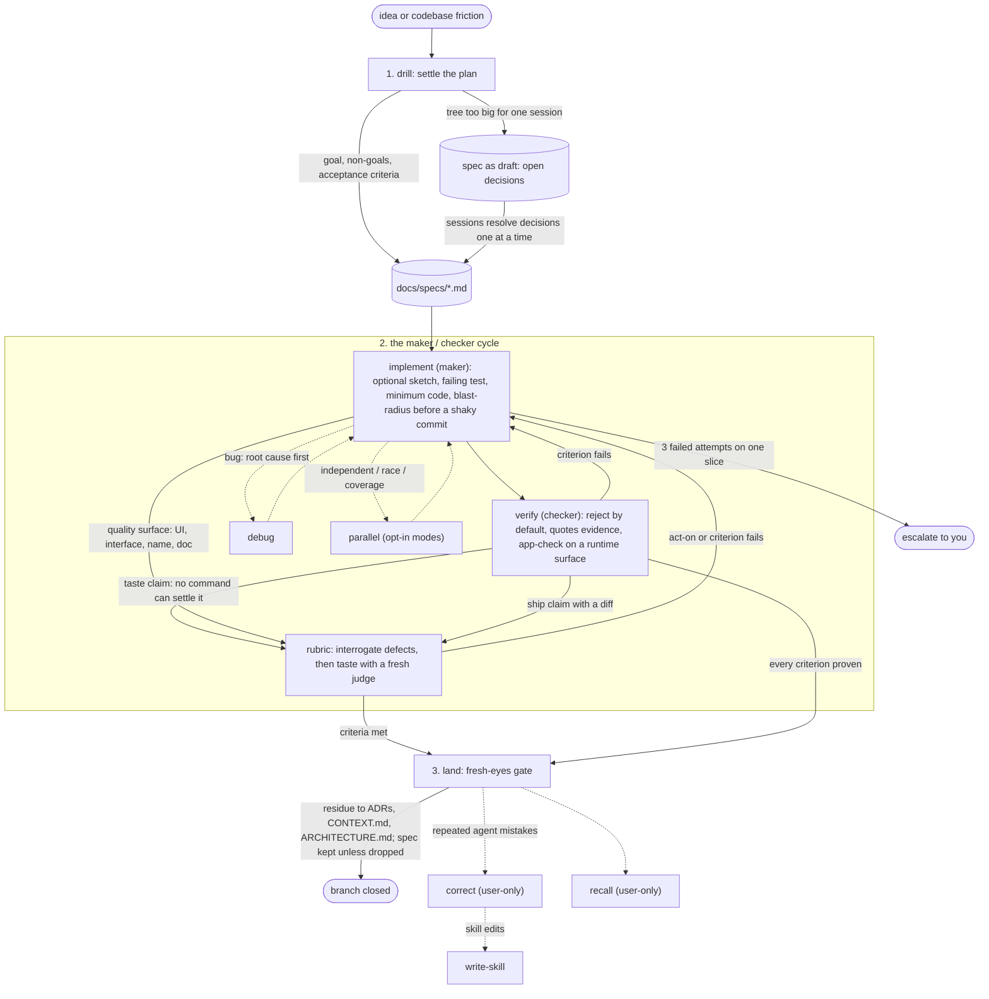

# skills

[](https://skills.sh/pwguler/skills)

Built against the Triple Debt Model (Storey, [arXiv:2603.22106](https://arxiv.org/abs/2603.22106))

## Install

Two paths, both for Claude Code. Pick one: installing both loads every skill twice.

**`npx skills`**:

```bash
npx skills add pwguler/skills
```

**Plugin** (updates via version):

```bash
claude plugin marketplace add pwguler/skills
claude plugin install pwguler-skills
```

Or in a Claude Code session:

```bash
/plugin marketplace add pwguler/skills
/plugin install pwguler-skills
```

Restart Claude Code after installing.

## Update

**`npx skills`**:

```bash
npx skills update
```

**Plugin**:

```bash
claude plugin update pwguler-skills
```

Restart Claude Code after updating.

## The loop

The base suite (drill → implement → verify → land) implements the run-until-done loop: a bounded goal, a maker/checker cycle, an exit only on proven criteria. `verify` drives a real runtime surface when one exists (app-check). `rubric` interrogates the diff for defects before judging taste. Fast path: an obvious task skips the interview; one sentence is the plan, once it passes the fork test. If `verify` fails twice on a fast-path task, the task was lying: route back through drill. `/deep` is user-only and turns every fast path off for the session. After land, `/correct` is user-only and encodes repeated agent mistakes; `/recall` tests your grasp of code the agent wrote.



The documents the suite maintains, all created lazily with no setup step: `CONTEXT.md` (domain glossary, born from the first resolved term), `ARCHITECTURE.md` (the system as it is), `DESIGN.md` (the look: tokens, type, color, spacing; `prototype` grounds in it), `docs/adr/` (hard-to-reverse decisions), `docs/specs/<slug>.md` (the loop's steering artifact; a spec kept after its branch is a record of why the code looks the way it does). These are shared project artifacts: committed, human-readable, reviewed in PRs. Claude's auto-memory is per-user preference and never replaces them; neither writes to the other.

## When to use what

| Moment | Skill |
|---|---|
| New plan, feature, or design, including the structure of a new codebase or area | `drill` |
| Any topic you want settled by being questioned one fork at a time (`drill` runs it for plans) | `core-interview` |
| A design fork needs a throwaway to react to | `prototype` |
| Implementing a settled plan | `implement` |
| Bug or unexpected behavior | `debug` |
| About to claim done, fixed, or passing; drive the real app | `verify` |
| Interrogate a diff for defects, or judge quality no command can settle | `rubric` |
| Reading legwork, or why code is shaped this way | `research` |
| Branch done, needs merging or a PR | `land` |
| Independent failures or tasks; opt-in race or coverage | `parallel` |
| Authoring or editing anything an agent reads | `write-skill` |
| A slice the agent wrote landed, test your understanding of it | `recall` |
| Encode repeated agent mistakes, or reflect a session | `correct` |
| A task finished, or catch up since your last message | `tldr` |
| Risky or ambiguous work, full rigor wanted | `deep` |
